# Taller práctico: Contenerización del Sistema de Administración de un Colegio

**Estudiante:** Mario Nicolás Poveda · **Curso:** Programación Web, grupo 02-04 · **Universidad Popular del Cesar** · Noviembre de 2026

**Repositorio:** https://github.com/Mario-Nicolas-Poveda/colegio-docker

**Imágenes:** `ghcr.io/mario-nicolas-poveda/colegio-api` y `ghcr.io/mario-nicolas-poveda/colegio-web`

> **Nota sobre el proyecto base.** El archivo `colegio-docker.zip` del curso no estaba disponible en el aula virtual. El proyecto se construyó siguiendo la estructura, la API y las versiones que describe el taller (React 19 + Vite + Tailwind v4, Node 22 + Express 5 en capas rutas → servicio → repositorio, PostgreSQL 17 y 20 pruebas con `node:test`), con base en las guías de Backend con Express, Partes I a V. Las salidas completas de cada comando están en `evidencias/faseN.txt` del repositorio.

## Arquitectura

```
Navegador → web (Nginx :8080) ──/api──→ api (Express :3000) ──SQL──→ db (PostgreSQL :5432)
            └────── red-web ──────────┘ └──────── red-datos (internal) ────────┘
```

---

## Fase 0. Preparación del entorno

- Docker 29.1.3 (Client y Server), Docker Compose v2.40.3, git 2.53 y Node 24.
- Primer commit: `Proyecto base sin contenerizar`.
- `secrets/db_password.txt` creado. `.gitignore` excluye `secrets/*.txt` y `.env`; se verificó con `git status` que no entran al repositorio.

## Fase 1. Primeros contenedores

```
$ docker run -d --name prueba-web -p 8080:80 nginx:1.29-alpine
$ curl -I http://localhost:8080          → HTTP/1.1 200 OK · Server: nginx/1.29.8
$ docker logs prueba-web                 → 172.17.0.1 - - "HEAD / HTTP/1.1" 200
$ docker exec prueba-web sh -c 'echo "<h1>Colegio</h1>" > /usr/share/nginx/html/index.html'
$ docker stop prueba-web && docker start prueba-web ; curl → <h1>Colegio</h1>
$ docker rm -f prueba-web ; docker run ... ; curl       → <title>Welcome to nginx!</title>

$ docker run --rm alpine ps              → PID 1 root ps
$ docker run --rm alpine hostname        → 7699a190a445
$ docker run --rm alpine ip addr         → lo 127.0.0.1/8 · eth0 172.17.0.2/16
$ docker run --rm --memory=64m alpine cat /sys/fs/cgroup/memory.max → 67108864

$ docker exec pg-temporal psql -U postgres -c "SELECT version();"
  PostgreSQL 17.12 on x86_64-pc-linux-musl, compiled by gcc (Alpine 15.2.0)
```

**(a) ¿Por qué el cambio sobrevivió a `stop/start` y no a `rm`?**
Cada contenedor tiene una **capa escribible** propia sobre las capas de solo lectura de la imagen. El `echo` escribió en esa capa. `stop`/`start` detiene y reanuda el *mismo* contenedor, así que la capa se conserva. `rm` elimina el contenedor junto con su capa escribible, y el `run` siguiente crea uno nuevo desde la imagen original. Por eso los datos que deben persistir van en volúmenes.

**(b) ¿Qué namespace explica cada resultado del paso 2?**

| Comando | Resultado | Mecanismo |
|---|---|---|
| `alpine ps` | Solo existe `PID 1 ps` | Namespace **pid**: árbol de procesos propio |
| `alpine hostname` | `7699a190a445` (ID del contenedor) | Namespace **uts**: nombre de host propio |
| `alpine ip addr` | `lo` y `eth0` 172.17.0.2/16 | Namespace **net**: pila de red propia, conectada al bridge `docker0` |
| `--memory=64m ... memory.max` | `67108864` bytes (64 MiB) | **cgroups v2**: no aísla, *limita*; el kernel aplica el tope de memoria |

**(c) Tamaños de las imágenes descargadas**

| Imagen | Tamaño |
|---|---|
| `postgres:17-alpine` | 424 MB |
| `nginx:1.29-alpine` | 93,5 MB |
| `alpine:latest` | 13 MB |
| `hello-world:latest` | 25,9 kB |

## Fase 2. Dockerfile de una sola etapa

| Imagen | Base | Tamaño | Reconstrucción tras cambiar `src/app.js` |
|---|---|---|---|
| `colegio-api:v1` | `node:22` | **1,64 GB** | **13,3 s**: `npm ci` se ejecuta otra vez |
| `colegio-api:v2` | `node:22-alpine` | **252 MB** | **3,4 s**: `npm ci` aparece como **CACHED** |

v1 hace `COPY . .` antes de `npm ci`, así que cualquier cambio en el código invalida esa capa y todas las siguientes. v2 copia primero solo `package.json` y `package-lock.json`, de modo que las dependencias se reconstruyen únicamente cuando cambian. Además usa Alpine, `--omit=dev`, `USER node` y la forma exec.


Sin variables obligatorias: `Faltan variables de entorno obligatorias: DB_NAME, DB_USER, DB_PASSWORD (o su versión _FILE)`.

**Forma exec frente a forma shell**

| Variante | PID 1 | `time docker stop` |
|---|---|---|
| `CMD ["node","src/server.js"]` (exec) | `node` | 0,90 s |
| `CMD node src/server.js` (shell, Alpine) | `node` | 1,22 s |
| `CMD npm start` (shell, v1) | `/bin/sh -c npm start` → `npm` → `sh` → `node` (PID 20) | 1,85 s |

`docker stop` envía SIGTERM **solo al PID 1** y, si no termina en 10 s, envía SIGKILL. En forma exec, `node` es el PID 1, recibe la señal y ejecuta el apagado ordenado de `server.js`: cierra el servidor HTTP y el pool de PostgreSQL. En forma shell, el PID 1 es `/bin/sh -c`, que normalmente no reenvía señales. En Alpine, el `sh` de busybox hace `exec` cuando el comando es uno solo, por eso `node` siguió siendo el PID 1 y la diferencia fue pequeña. Con `npm start`, `node` quedó tres procesos por debajo y el apagado dependió de que npm reenviara la señal. La forma exec es la única que garantiza el comportamiento.

## Fase 3. Multi-stage builds

| Imagen | Tamaño | Contenido |
|---|---|---|
| `colegio-api:v1` | 1,64 GB | Debian + Node + devDependencies + código + `test/` |
| `colegio-api:v2` | 252 MB | Alpine con dependencias de producción |
| `colegio-api:local` (multi-stage) | **245 MB** | Solo `node_modules`, `package.json` y `src` (sin `test/`), usuario `node` |
| `colegio-web:dev` | 355 MB | Node + Vite + código fuente |
| `colegio-web:local` (multi-stage) | **81,9 MB** | Nginx sin privilegios + 270 kB de `dist/`, sin Node |

- Etapa `pruebas` con el código correcto: `tests 20 · pass 20 · fail 0`.
- `docker run --rm colegio-web:local id` → `uid=101(nginx)`; `which node` → sin resultado.

**Prueba rota a propósito** (`grado: 12` → `grado: 10` en "rechaza un grado fuera del rango"): la construcción se detiene en la etapa de pruebas.


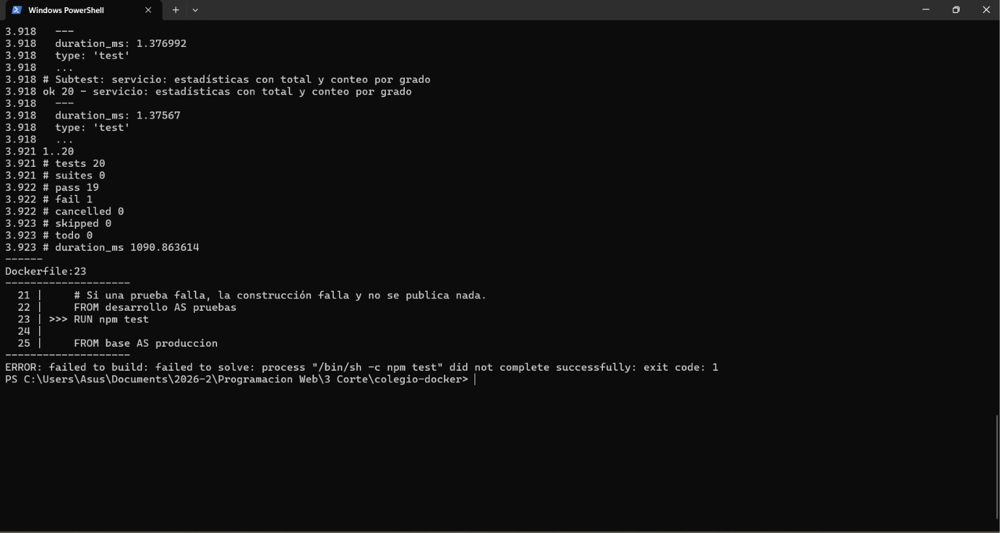

## Fase 4. Redes y volúmenes a mano

El sistema se levantó con comandos `docker`: red `red-web`, red `red-datos --internal`, volumen `datos-db`, la base de datos con los scripts de `db/init` y el secreto montado como archivo, la API conectada a las dos redes y el frontend publicado en el puerto 8080.


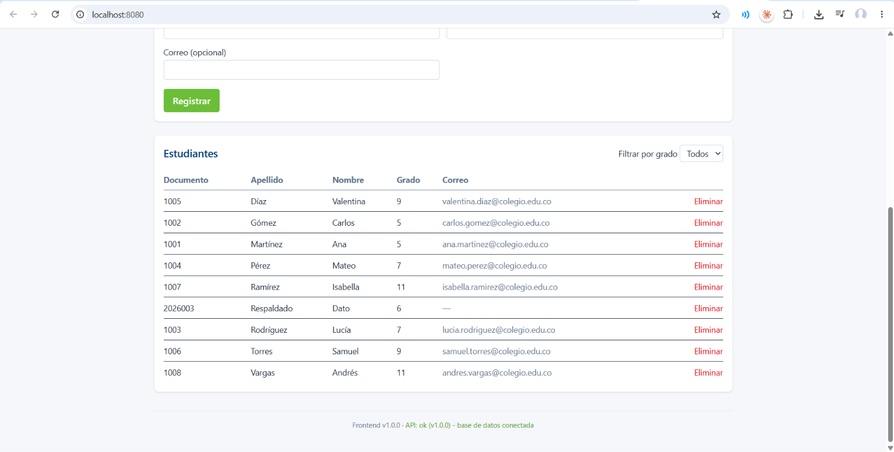


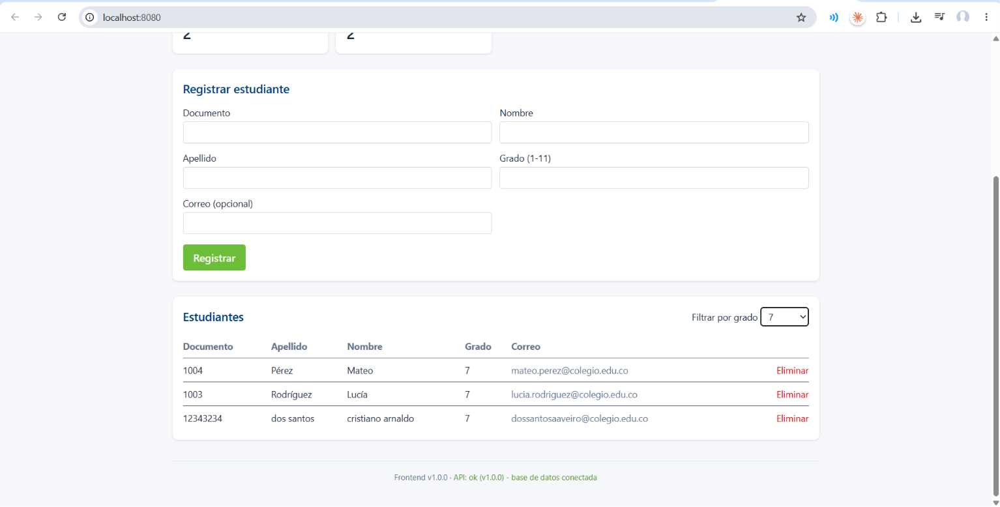

**Aislamiento de redes**

| Comando | Resultado | Explicación |
|---|---|---|
| `docker exec web nslookup api` | `Address: 172.19.0.2` | `web` y `api` comparten `red-web`; el DNS interno de Docker resuelve el nombre del contenedor |
| `docker exec web nslookup db` | `Can't find db: No answer` | `web` no está en `red-datos`: el frontend no puede llegar a la base de datos |
| `docker exec db ping -c 1 8.8.8.8` | `Network unreachable` | `red-datos` es interna y no tiene salida a internet |

- **Persistencia:** después de `docker rm -f db` y de crear un contenedor nuevo con el mismo volumen, `docker logs db | grep -c initdb.d` → **0**: los scripts no se ejecutan con el volumen lleno, y el estudiante registrado sigue ahí.
- **Respaldo:** `respaldo-fase4.sql` (125 líneas) generado con `pg_dump`.
- **Comandos necesarios:** 10 (2 redes, 1 volumen, 3 `run`, 1 `network connect` y verificaciones).
- **Errores cometidos:** en Git Bash para Windows, rutas como `/run/secrets/...` y `/sys/...` se convertían en rutas de Windows (`C:/Program Files/Git/...`). Se resolvió con `MSYS_NO_PATHCONV=1` y con `$(pwd -W)` para los bind mounts.

## Fase 5. Orquestación con Docker Compose

Con un solo comando (`docker compose up -d --build`) el sistema arranca en orden: `db` sana → `api` sana → `web`. Solo `web` (8080) y `adminer` (8081) se publican hacia fuera.

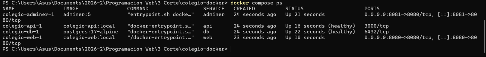


**Comportamiento ante fallos (paso 5)**

- `docker compose stop db` → `/api/salud` responde **503**. A los ~55 s, `api` aparece **(unhealthy)**: 5 intentos fallidos cada 10 s. El proceso sigue vivo; solo informa que no está sano.
- `docker compose start db` → `api` vuelve a **(healthy)** sin reiniciarse, porque el pool de `pg` reconecta solo.
- `docker compose exec api kill 1` → el proceso principal termina y Docker lo reinicia por `restart: unless-stopped`: **RestartCount pasa de 0 a 1**.
- `docker compose stop api` → `Exited (0)` y **no** se reinicia. La política de reinicio actúa cuando el contenedor termina por sí mismo; una detención manual se respeta.

**Recarga en caliente (paso 6).** En Docker Desktop para Windows, los bind mounts de `compose.dev.yaml` no generan eventos de archivos dentro del contenedor, como advierte la sección de solución de problemas. Se añadió `compose.watch.yaml` con **Compose Watch** (Módulo 5.7):

```
docker compose -f compose.yaml -f compose.dev.yaml -f compose.watch.yaml up --build --watch
```

- Al editar `backend/src/app.js`: `Syncing service "api"` → `Restarting 'src/server.js'`, y `/api/salud` devuelve `"colegio":"UNICESAR"`.
- Al editar `Header.jsx`: `Syncing service "web"` → `[vite] hmr update /src/components/Header/Header.jsx`, y el navegador se actualiza sin recargar la página.

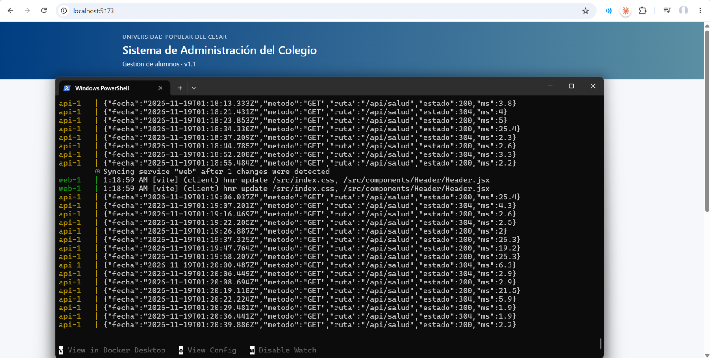

**Ciclo de los datos (paso 7):** con un estudiante extra el total es 9 → `down` + `up`: **9**, porque el volumen se conserva → `down -v` + `up`: **8**, porque el volumen se borró y los scripts vuelven a cargar los datos iniciales.

## Fase 6. Registro de imágenes y CI/CD

El workflow `.github/workflows/docker.yml` construye la etapa `pruebas` y, solo si pasa y el evento no es un pull request, publica `colegio-api` y `colegio-web` en GHCR en paralelo, con etiquetas calculadas por `docker/metadata-action`.


**Pull request que falla.** Rama `prueba-rota` con la prueba de grado modificada:

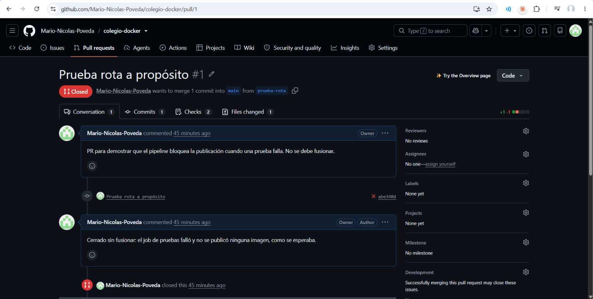

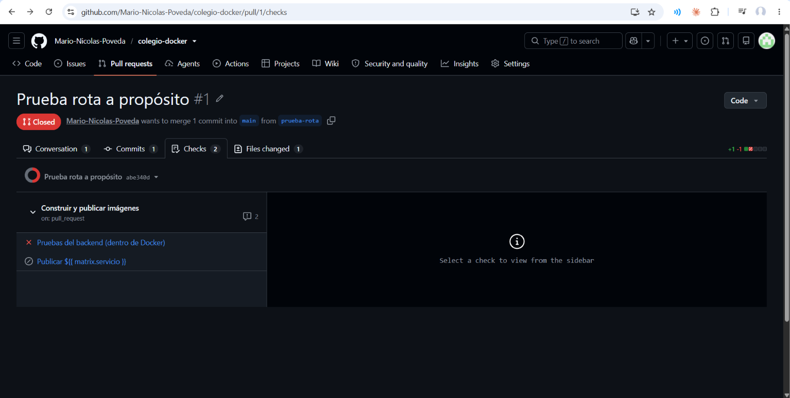

El job `Publicar` aparece como `${{ matrix.servicio }}` sin expandir porque **nunca llegó a ejecutarse**: no se publicó ninguna imagen. El log de CI muestra el mismo fallo que el build local de la Fase 3:

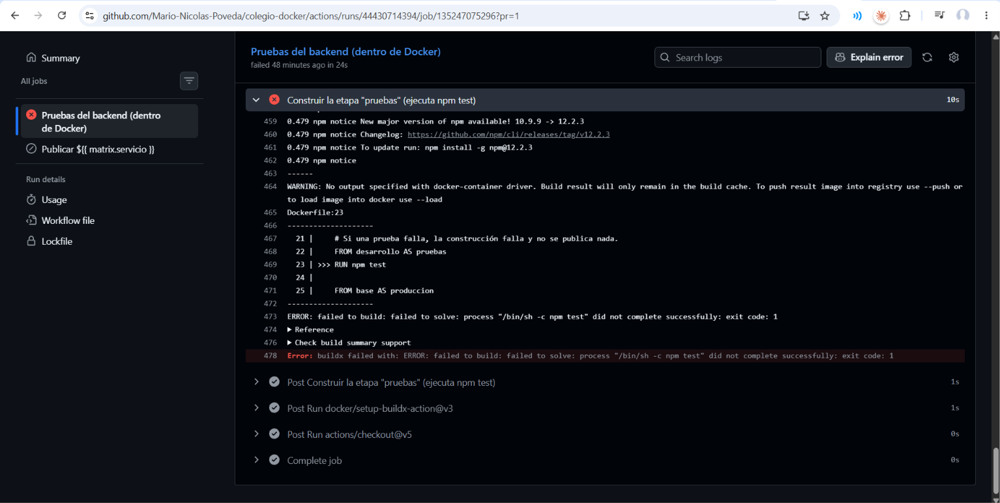

A diferencia de la publicación manual, el pipeline publica solo si las pruebas pasan, y calcula las etiquetas semánticas y del commit sin intervención manual.

## Fase 7. Producción y observabilidad

**Despliegue desde el registro.** En la carpeta `despliegue-colegio` solo están `compose.yaml`, `compose.prod.yaml`, `db/`, `secrets/` y `.env` (con `IMAGEN_PREFIJO=ghcr.io/mario-nicolas-poveda/colegio` y `TAG=1.0.0`), sin código fuente. Se ejecutó `docker compose pull` y `docker compose up -d --no-build`.

**Recursos bajo carga (3000 peticiones a `/api/estudiantes`):**

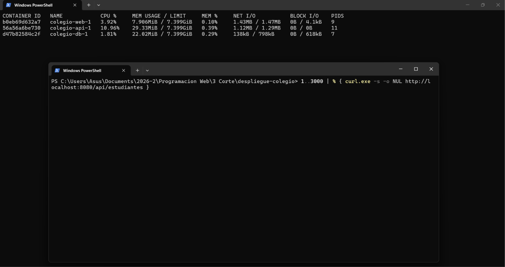

| Contenedor | CPU | Memoria |
|---|---|---|
| colegio-api-1 (Node) | 10,96 % | 29,3 MiB |
| colegio-web-1 (Nginx) | 3,92 % | 7,9 MiB |
| colegio-db-1 (PostgreSQL) | 1,81 % | 22,0 MiB |

La API hace la mayor parte del trabajo, Nginx casi no consume al servir y reenviar, y los tres servicios juntos usan menos de 60 MiB.

**Análisis de logs:**

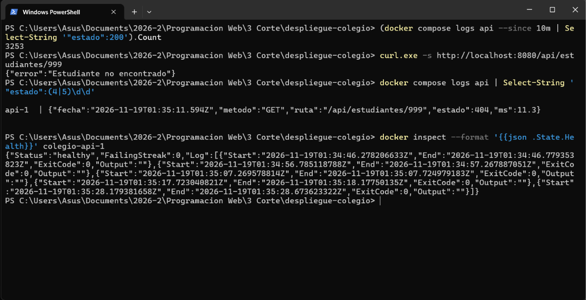

- **3253** respuestas 200 en los últimos 10 minutos.
- Un solo error, el `404` de `/api/estudiantes/999` provocado a propósito; ningún 5xx bajo carga.
- `State.Health`: `healthy`, `FailingStreak: 0`, con los últimos 5 chequeos en `ExitCode 0`.

**Actualización a 1.1.0** (cambio visible en el subtítulo):

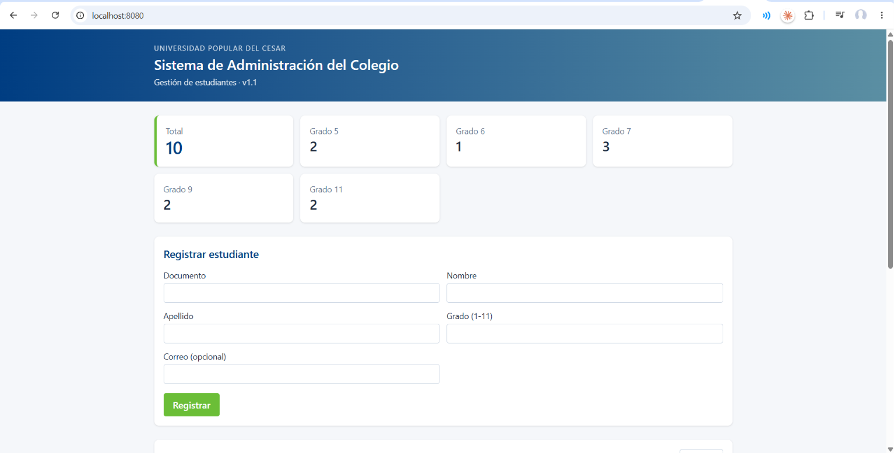

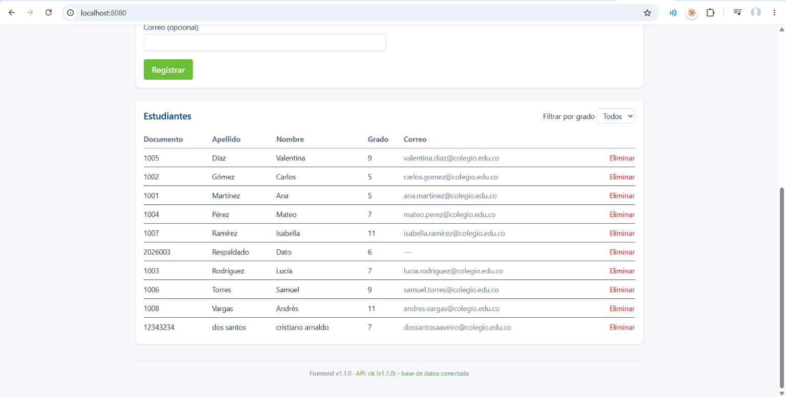

**Reversión a 1.0.0:**


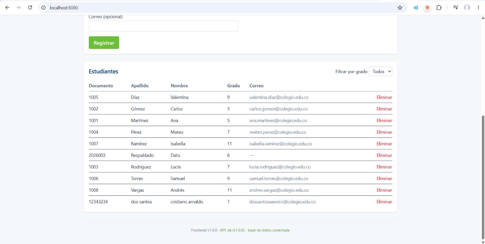

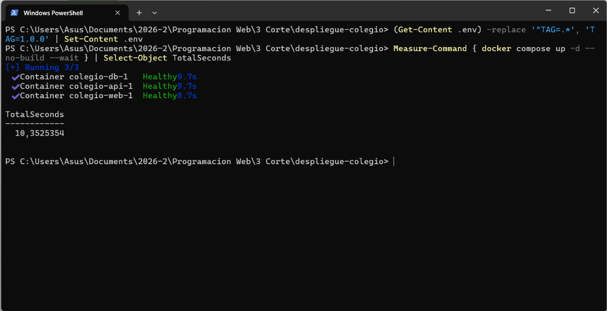

| Operación | Tiempo |
|---|---|
| Actualización a 1.1.0 (`pull` + `up -d --no-build`) | 17,6 s |
| Reversión a 1.0.0 (imagen ya en caché) | **10,35 s** |

La reversión es más rápida porque no hay nada que descargar: solo se recrean `api` y `web`. `db` y su volumen no se tocan, y por eso los 10 estudiantes siguen presentes en las dos versiones.

**Respaldo, desastre y restauración** con `respaldar.sh`:

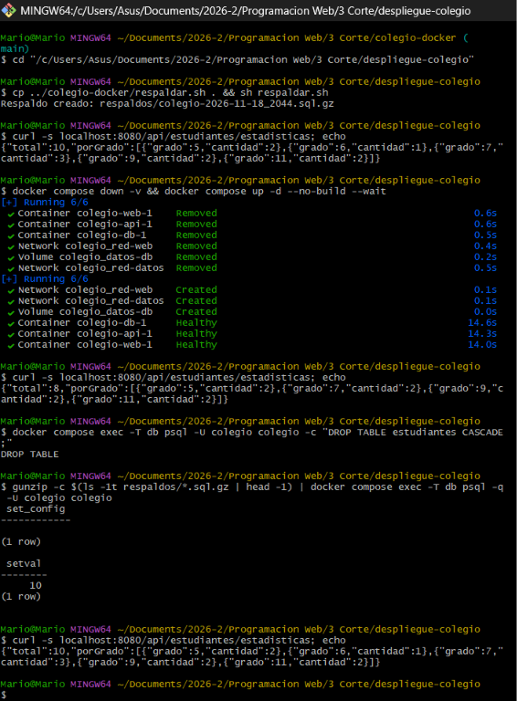

Los scripts de `db/init` recrean la tabla al iniciar un volumen vacío, así que antes de restaurar se elimina (`DROP TABLE estudiantes CASCADE`); si no, el respaldo choca con la tabla existente. En un servidor real, `respaldar.sh` se programaría con `cron`.

**Parte B (opcional):** no se realizó por no contar con un VPS ni un dominio. `compose.prod.yaml` con Traefik, HTTPS de Let's Encrypt, redirección HTTP → HTTPS y el puerto 8080 sin publicar quedó listo y validado con `docker compose config`.

---

## Resumen de entregables

| Entregable | Estado |
|---|---|
| Repositorio en GitHub sin secretos | ✅ https://github.com/Mario-Nicolas-Poveda/colegio-docker |
| Imágenes `colegio-api` y `colegio-web` en GHCR con `1.0.0`, `1.0`, `sha-*` y `latest` | ✅ públicas |
| Informe con evidencias y respuestas | ✅ este documento |
| `README.md` con instrucciones de desarrollo y producción | ✅ |
| URL pública con HTTPS (opcional) | ❌ sin VPS ni dominio; configuración lista |
