# Informe del taller práctico de contenerización

Sistema de Administración de un Colegio

Mario Nicolás Poveda
Programación Web, grupo 02-04
Universidad Popular del Cesar
Noviembre de 2026

Repositorio: https://github.com/Mario-Nicolas-Poveda/colegio-docker

Imágenes publicadas: ghcr.io/mario-nicolas-poveda/colegio-api y ghcr.io/mario-nicolas-poveda/colegio-web

## Introducción

En este taller se contenerizó y desplegó una versión reducida del sistema del colegio, formada por tres servicios: un frontend en React servido con Nginx, una API REST en Express y una base de datos PostgreSQL. El archivo colegio-docker.zip del curso no estaba disponible en el aula virtual, así que el proyecto base se armó siguiendo la estructura y los endpoints que indica el taller y lo visto en las guías de Backend con Express. Las salidas completas de los comandos de cada fase están en la carpeta evidencias del repositorio.

## Fase 0. Preparación del entorno

Se verificó que estuvieran instalados Docker 29.1.3, Docker Compose 2.40.3, Git 2.53 y Node. Después se creó el archivo secrets/db_password.txt y se hizo el primer commit del proyecto sin archivos de Docker. Con git status se comprobó que el archivo del secreto y el .env no entran al repositorio porque están en el .gitignore.

## Fase 1. Primeros contenedores

Salida resumida de los comandos de esta fase:

```
$ docker run -d --name prueba-web -p 8080:80 nginx:1.29-alpine
$ curl -I http://localhost:8080
HTTP/1.1 200 OK
Server: nginx/1.29.8

$ docker exec prueba-web sh -c 'echo "<h1>Colegio</h1>" > /usr/share/nginx/html/index.html'
$ docker stop prueba-web && docker start prueba-web
$ curl http://localhost:8080
<h1>Colegio</h1>
$ docker rm -f prueba-web && docker run -d --name prueba-web -p 8080:80 nginx:1.29-alpine
$ curl http://localhost:8080
<title>Welcome to nginx!</title>

$ docker run --rm alpine ps
PID   USER     TIME  COMMAND
    1 root      0:00 ps
$ docker run --rm alpine hostname
7699a190a445
$ docker run --rm alpine ip addr
1: lo ... inet 127.0.0.1/8
2: eth0 ... inet 172.17.0.2/16
$ docker run --rm --memory=64m alpine cat /sys/fs/cgroup/memory.max
67108864

$ docker exec pg-temporal psql -U postgres -c "SELECT version();"
PostgreSQL 17.12 on x86_64-pc-linux-musl
```

a) El cambio sobrevivió a stop/start pero no a rm porque cada contenedor tiene su propia capa escribible encima de la imagen. Al hacer stop y start se usa el mismo contenedor, así que esa capa sigue ahí. Con rm el contenedor se elimina junto con su capa, y el siguiente run parte otra vez de la imagen original. Por eso los datos que se quieren conservar deben ir en un volumen.

b) Cada resultado del paso 2 se explica por un namespace distinto. ps solo muestra un proceso con PID 1 por el namespace pid, que le da al contenedor su propio árbol de procesos. hostname devuelve el ID del contenedor por el namespace uts. ip addr muestra una interfaz eth0 propia con la IP 172.17.0.2 por el namespace net. El valor 67108864 (64 MiB) de memory.max no viene de un namespace sino de los cgroups, que se encargan de limitar los recursos.

c) Tamaños de las imágenes descargadas: postgres:17-alpine 424 MB, nginx:1.29-alpine 93,5 MB, alpine 13 MB y hello-world 25,9 kB.

## Fase 2. Dockerfile de una sola etapa

Primero se construyó la versión 1 del Dockerfile, basada en node:22 y con COPY . . antes de npm ci. Luego se hizo la versión 2 con node:22-alpine, copiando primero package.json y package-lock.json, instalando solo dependencias de producción y ejecutando como el usuario node.

| Imagen | Tamaño | Reconstrucción después de cambiar app.js |
|---|---|---|
| colegio-api:v1 | 1,64 GB | 13,3 s (npm ci se ejecuta de nuevo) |
| colegio-api:v2 | 252 MB | 3,4 s (npm ci sale como CACHED) |

La diferencia de tiempo se debe al orden de las instrucciones. En la v1, cualquier cambio en el código invalida la capa del COPY y con ella el npm ci. En la v2 las dependencias están en una capa anterior al código, así que solo se reinstalan si cambia el package.json.

Al ejecutar la API sin base de datos, /api/salud responde 503 y whoami muestra que el proceso corre como node:

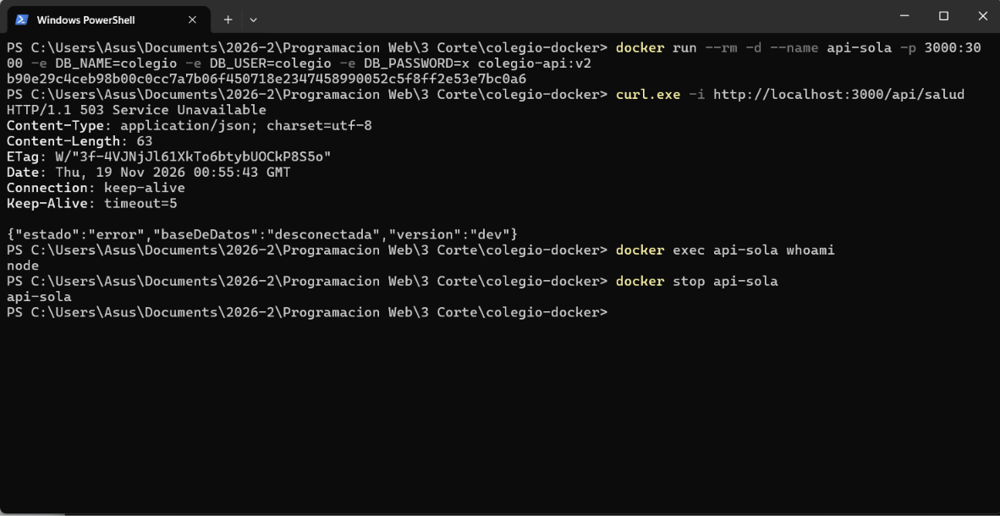

Si se ejecuta sin variables, la API termina con el mensaje "Faltan variables de entorno obligatorias: DB_NAME, DB_USER, DB_PASSWORD".

Para comparar la forma exec con la forma shell se midió el tiempo de docker stop:

| CMD | Proceso con PID 1 | docker stop |
|---|---|---|
| ["node", "src/server.js"] | node | 0,90 s |
| node src/server.js | node | 1,22 s |
| npm start (v1) | /bin/sh -c npm start | 1,85 s |

docker stop le manda SIGTERM solo al proceso con PID 1. Con la forma exec ese proceso es node, que recibe la señal y cierra el servidor y la conexión a la base de datos de forma ordenada. Con la forma shell el PID 1 suele ser /bin/sh, que no reenvía la señal, y Docker termina matando el proceso a los 10 segundos. En las pruebas la diferencia fue pequeña porque en Alpine el sh ejecuta directamente el comando cuando es uno solo, y porque las versiones recientes de npm sí reenvían la señal. Aun así, en la v1 se ve que node quedó como PID 20 debajo de sh y npm, y la forma exec es la única que asegura un apagado correcto.

## Fase 3. Multi-stage builds

Se reemplazaron los Dockerfiles por versiones de varias etapas. En la API hay etapas de dependencias, desarrollo, pruebas y producción. En el frontend, una etapa compila con Vite y la imagen final solo lleva Nginx con los archivos generados.

| Imagen | Tamaño |
|---|---|
| colegio-api:v1 | 1,64 GB |
| colegio-api:v2 | 252 MB |
| colegio-api:local | 245 MB |
| colegio-web:dev | 355 MB |
| colegio-web:local | 81,9 MB |

La imagen final de la API solo contiene node_modules, package.json y src, sin la carpeta de pruebas. La del frontend corre como uid=101(nginx) y no tiene Node instalado.

La etapa de pruebas ejecuta las 20 pruebas durante la construcción. Para comprobar que funciona se cambió grado: 12 por grado: 10 en la prueba "rechaza un grado fuera del rango", y la construcción se detuvo:

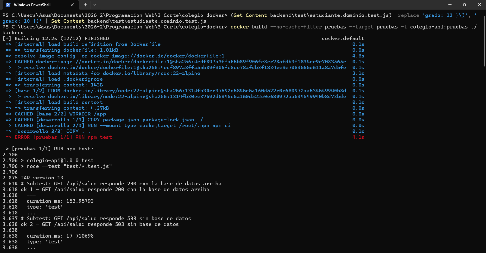


## Fase 4. Redes y volúmenes a mano

Antes de usar Compose se levantaron los tres contenedores con comandos docker: dos redes (red-web y red-datos, esta última interna), un volumen para la base de datos y la contraseña montada como archivo. En total fueron 10 comandos.

La aplicación quedó funcionando en http://localhost:8080:

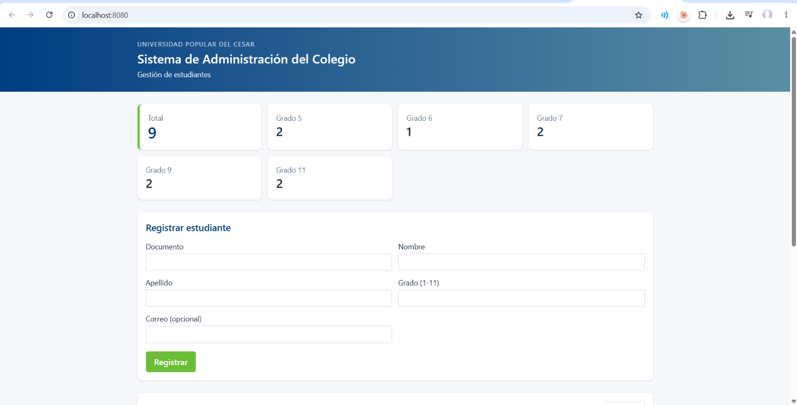


Se registró un estudiante nuevo y aparece al filtrar por su grado:

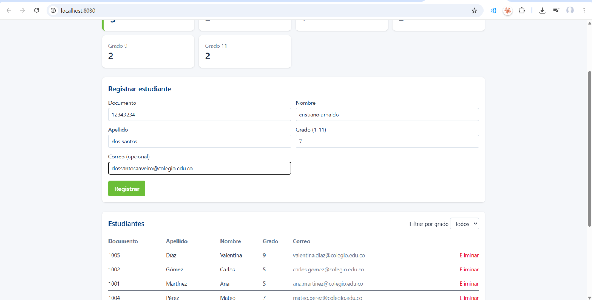


Resultados del paso 5:

- docker exec web nslookup api resuelve a 172.19.0.2, porque web y api están en red-web.
- docker exec web nslookup db falla, porque web no está en red-datos y no puede ver la base de datos.
- docker exec db ping 8.8.8.8 da "Network unreachable", porque red-datos es interna y no tiene salida a internet.

Para probar la persistencia se eliminó el contenedor db y se creó otro con el mismo volumen. Los scripts de inicialización no se volvieron a ejecutar (grep -c initdb.d devolvió 0) y el estudiante registrado seguía apareciendo. Al final se sacó un respaldo con pg_dump en respaldo-fase4.sql.

El principal problema fue que Git Bash en Windows convierte las rutas como /run/secrets en rutas de Windows. Se solucionó usando MSYS_NO_PATHCONV=1 y pwd -W para los montajes.

## Fase 5. Docker Compose

Con el archivo compose.yaml todo el sistema se levanta con un solo comando. Gracias a los healthchecks y a depends_on, primero arranca db, luego api cuando la base de datos está lista y por último web.


Con el perfil herramientas se levanta Adminer en el puerto 8081:

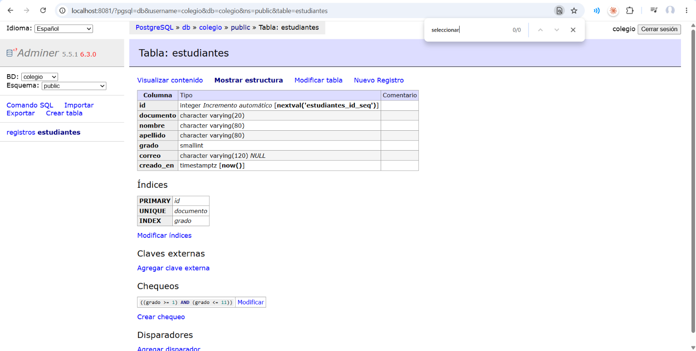

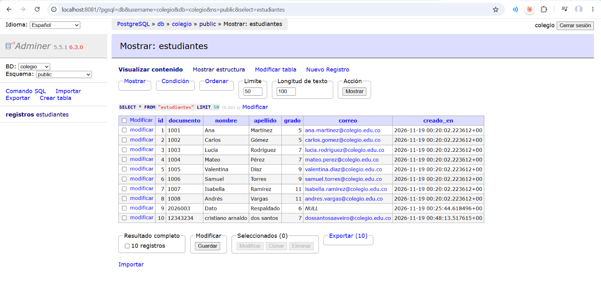

Comportamiento ante fallos:

- Al detener db, /api/salud responde 503 y a los 55 segundos aproximadamente api aparece como unhealthy. El proceso sigue vivo; solo indica que no puede trabajar.
- Al volver a iniciar db, api vuelve a healthy sin reiniciarse, porque el pool de conexiones se reconecta solo.
- Con kill 1 dentro de api el proceso termina y Docker lo reinicia por la política restart: unless-stopped. El RestartCount pasó de 0 a 1.
- Con docker compose stop api el contenedor queda detenido y no se reinicia. La política de reinicio solo actúa cuando el contenedor termina por su cuenta, no cuando uno lo detiene a propósito.

Para la recarga en caliente, los bind mounts de compose.dev.yaml no detectaban los cambios en Docker Desktop para Windows. Por eso se agregó el archivo compose.watch.yaml, que usa Compose Watch para copiar los cambios dentro del contenedor:

```
docker compose -f compose.yaml -f compose.dev.yaml -f compose.watch.yaml up --build --watch
```

Al cambiar el subtítulo en Header.jsx, la página se actualizó sola y en los logs aparecen el "Syncing service web" y el "hmr update" de Vite. Al cambiar app.js, la API se reinició con node --watch.


Sobre el ciclo de los datos: con docker compose down los datos se conservan porque el volumen no se borra, mientras que con down -v se elimina el volumen y al volver a subir solo quedan los 8 estudiantes iniciales.

## Fase 6. Registro y CI/CD

El workflow de GitHub Actions primero construye la etapa de pruebas. Si pasan y el evento no es un pull request, construye y publica las imágenes de api y web en GitHub Container Registry. Las etiquetas se calculan a partir del tag de versión y del commit.

Ejecución del tag v1.0.0:

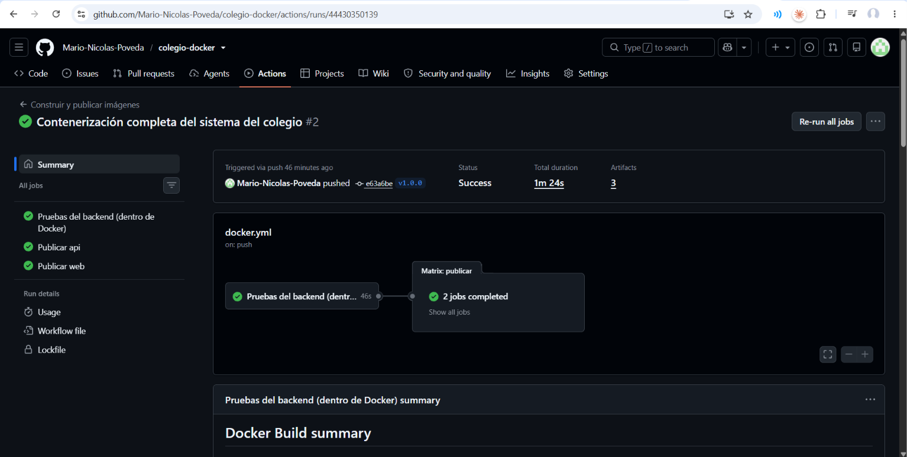

Paquete colegio-api con sus etiquetas:

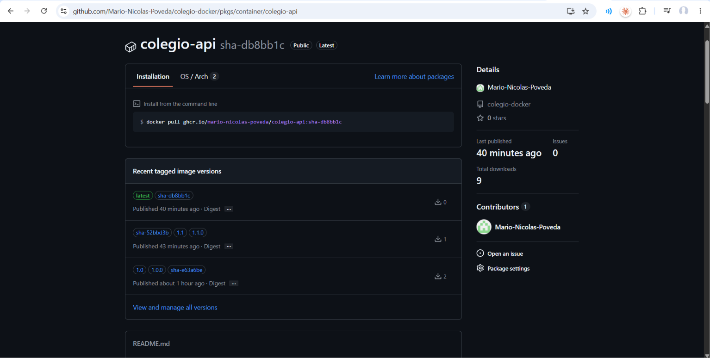

Para probar que el pipeline no publica nada si una prueba falla, se abrió un pull request desde la rama prueba-rota con la prueba modificada. El job de pruebas falló, el de publicar no se ejecutó y el pull request se cerró sin fusionar.


El error en GitHub es el mismo que se obtuvo en local en la fase 3, en la línea RUN npm test del Dockerfile.

## Fase 7. Producción y observabilidad

Para simular producción se creó una carpeta aparte, despliegue-colegio, con solo los archivos de Compose, los scripts de la base de datos, el secreto y un .env apuntando a las imágenes de GHCR. Desde ahí se descargó y levantó la versión 1.0.0 sin código fuente.

Uso de recursos durante una carga de 3000 peticiones:


La API fue la que más CPU usó (cerca del 11 %), mientras que Nginx y PostgreSQL se mantuvieron por debajo del 4 %. Entre los tres contenedores no llegaron a 60 MiB de memoria.

Análisis de los logs:


Hubo 3253 respuestas con estado 200 en los últimos 10 minutos y un solo error, un 404 provocado a propósito. No apareció ningún error 5xx y el healthcheck de la API seguía en healthy.

Después se publicó la versión 1.1.0 con un cambio en el subtítulo y se actualizó cambiando el TAG en el .env:


Luego se volvió a la versión 1.0.0:

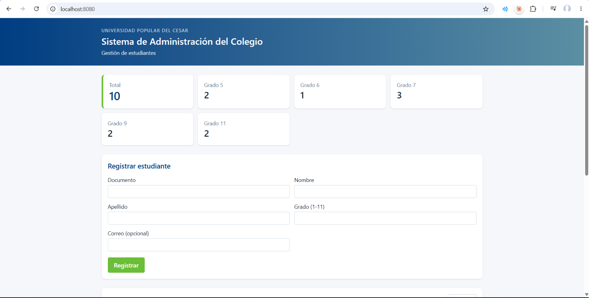


La actualización tardó 17,6 s porque tuvo que descargar las imágenes nuevas, y la reversión 10,35 s porque la versión anterior ya estaba en el equipo. En ambos casos los datos se mantuvieron, porque solo se recrean los contenedores de api y web y el volumen de la base de datos no se toca.

Por último se probó el respaldo con el script respaldar.sh. Se sacó el respaldo con 10 estudiantes, se simuló la pérdida de datos con docker compose down -v (quedaron 8) y se restauró, volviendo a 10:


Antes de restaurar hubo que borrar la tabla, porque al iniciar con el volumen vacío los scripts de db/init la vuelven a crear y el respaldo choca con ella.

La parte B, el despliegue con HTTPS en un VPS, no se hizo porque no se contaba con un servidor ni con un dominio. El archivo compose.prod.yaml con Traefik sí quedó configurado en el repositorio.

## Reto adicional: escaneo de seguridad con Trivy

Se agregó al workflow un job de seguridad que construye la imagen de producción de cada servicio y la escanea con Trivy. Primero muestra un reporte de las vulnerabilidades altas y críticas, y después falla si encuentra alguna crítica que ya tenga corrección disponible. El job de publicar ahora depende tanto de las pruebas como de este escaneo, así que una imagen con vulnerabilidades críticas no llega al registro.

El cambio se subió en el pull request #2. En la primera ejecución el escaneo de web falló por una vulnerabilidad crítica en el paquete brotli-libs de la imagen base de Nginx (CVE-2026-111497), y la publicación no se ejecutó:

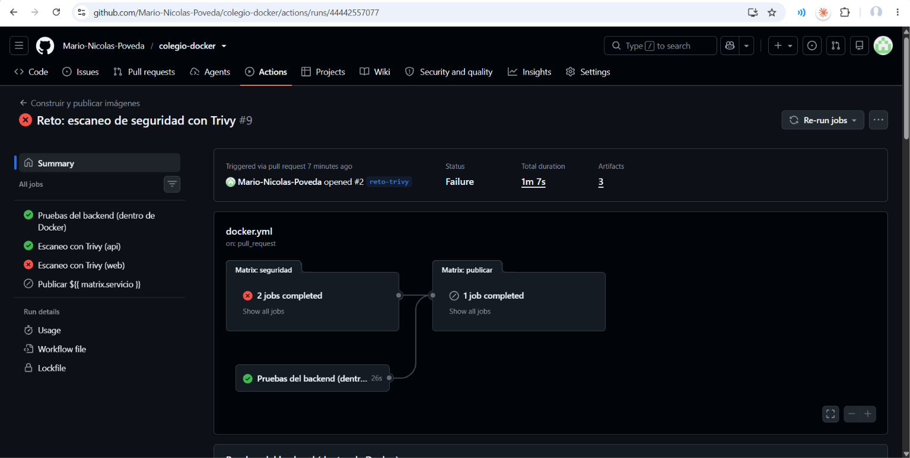

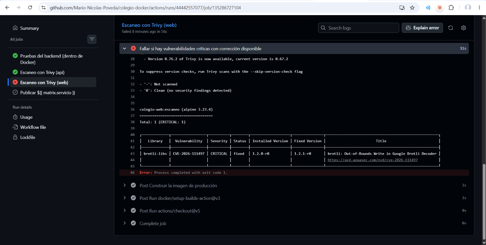

Para corregirlo se modificaron los Dockerfiles. En el frontend se agregó apk upgrade en la etapa final para actualizar los paquetes de Alpine, manteniendo el usuario sin privilegios. En la API se quitó npm de la imagen de producción, ya que solo se usa node para ejecutarla y npm traía sus propias dependencias vulnerables. Con eso el escaneo pasó:

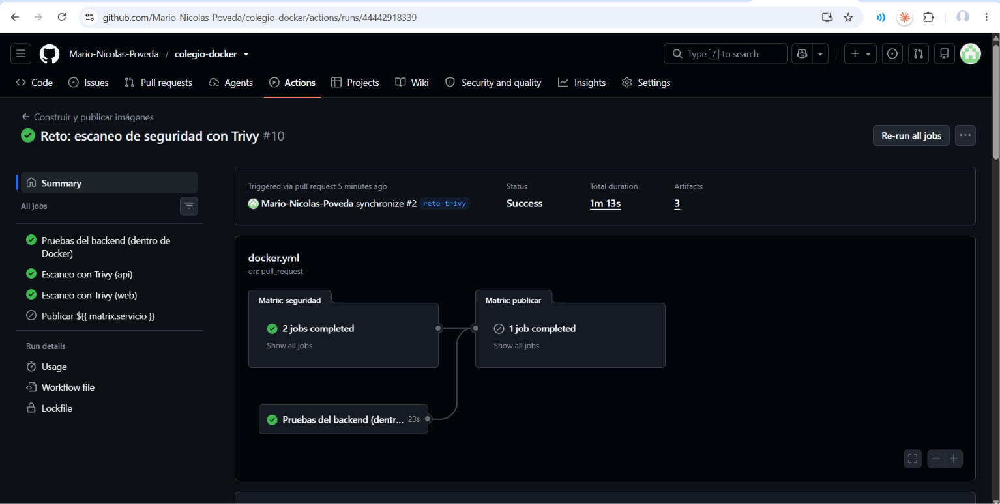

| Imagen | Antes | Después |
|---|---|---|
| colegio-web | 1 crítica, 56 altas | 0 críticas, 0 altas |
| colegio-api | 0 críticas, 10 altas | 0 críticas, 0 altas |

Como contrapartida, la imagen web pasó de 81,9 MB a 116 MB por la capa que agrega la actualización de paquetes, y la de la API de 245 MB a 254 MB. El pull request se fusionó en main y las imágenes corregidas se publicaron como versión 1.2.0.

## Conclusiones

Con Docker la aplicación se ejecuta igual en cualquier equipo, y con Compose el sistema completo se levanta con un solo comando y en el orden correcto. Los multi-stage builds redujeron la imagen de la API de 1,64 GB a 245 MB y dejaron la del frontend en 81,9 MB. Con el pipeline de GitHub Actions, cada versión se prueba antes de publicarse, y desplegar, actualizar o revertir se reduce a cambiar una etiqueta en el .env.
